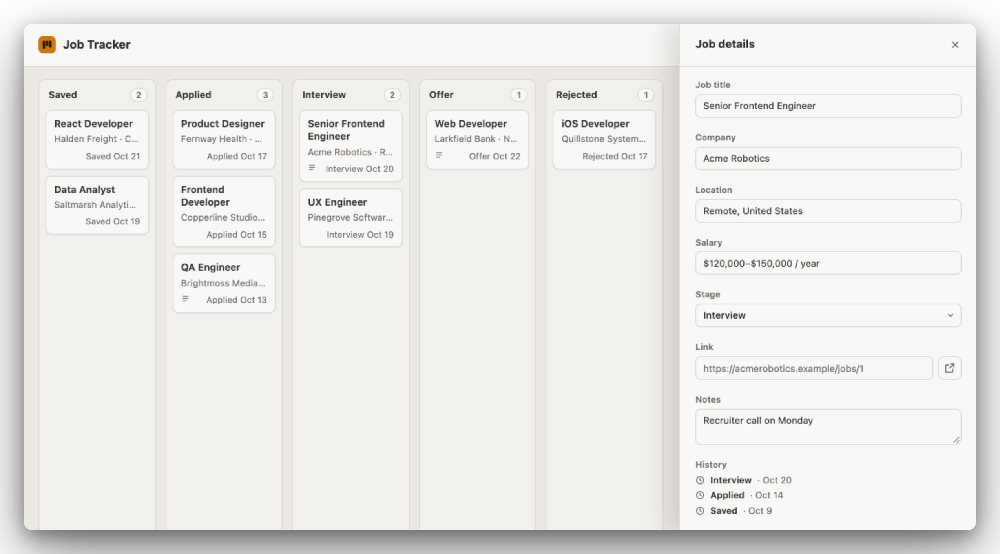
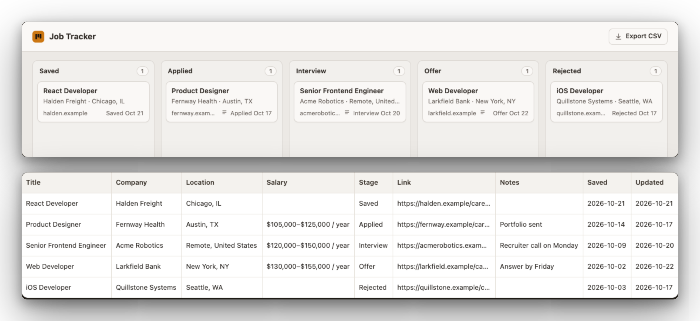

# Job Tracker: free Chrome extension

Forty open tabs with job postings, a notes app with scattered lines, a Google Sheets list you gave up by week two. Sound familiar? A **job application tracker** fixes the part willpower can't: one click saves any posting, and a kanban board keeps every application in order. The fix is deliberately boring: no system to learn, no ritual to keep.

  

## What it does

The whole loop, end to end. Saving takes one click: Job Tracker picks up the job title, the company and the link automatically while the posting is open, from Indeed, LinkedIn or any site with a listing. No typing, no copy-paste, no "I'll save it later" (you won't). The saving happens where the browsing happens; nothing asks you to fill in fields first.

Two more ways in: right-click any link and the job is saved without opening it, which is exactly what a long page of search results needs; and `Alt+Shift+J` saves the page you're on from any tab. On LinkedIn, a role opened straight from search results is captured the same way. Bulk browsing stays cheap: scanning forty postings costs you forty glances, not forty forms.

Everything lands on a **kanban board** with five columns: Saved, Applied, Interview, Offer, Rejected. Drag a card and the status changes. That's the whole status-update workflow. Every card holds **notes**: the recruiter's name, the salary discussed, the next step and when. Notes are the difference between "I applied somewhere last week" and knowing exactly where you stand. **CSV export** hands you the entire board in one file when you need a clean summary. Dark theme included, for the late-night application push.

  

## Who it's for

People in the middle of a real job hunt: candidates sending applications by the dozen, graduates applying to everything that moves, career changers rebuilding from zero, and everyone whose neatly typed list died by week two. If you apply to ten roles a week, your system should be faster than your spreadsheet. That's the bar this **job tracker** sets: capture in a second, see the whole hunt on one screen, and never lose a role to a tab graveyard again. If updating the system takes longer than applying, the system loses; this one updates while you apply.

## Quick start

1. Install the extension from the [Chrome Web Store](https://chromewebstore.google.com/detail/job-tracker/ioeigcamlaacnjcdjppfmjapmakanpcb) (free, one click).
2. Open a job posting and hit `Alt+Shift+J`, and it's saved. Title, company, link, done.

That's the entire onboarding. The card lands in **Saved** and waits there: drag it to **Applied** when the application goes out, to **Interview** when the call comes in. Add a note before the recruiter call, export the CSV when you want a clean summary for yourself.

## Questions and answers

### How to track job applications without a spreadsheet?

Honestly, most people can't, and it isn't laziness: the old way is manual input, every row typed by hand, every status updated twice, and the system dies exactly when the search gets busy. A **job application tracker** flips the input problem: the posting saves itself as you browse, and the board shows the state of every application without any typing. You do the applying, the extension does the bookkeeping.

### Does it work with LinkedIn and Indeed?

Yes. A role opened from LinkedIn search results is saved the same way as any posting: title, company and link come along automatically. As a **job search tracker** it also holds postings from Indeed, company career pages and niche boards alike. Mixing sources is normal; most hunts run across several sites in the same week. The board doesn't care where a job came from; it cares what happens next.

### Is my data private, and where is it stored?

In your browser, locally. Job Tracker has no account, no login and nothing uploaded: the board, the notes and the exports exist on your machine and nowhere else. There is no analytics hiding in that answer either: nothing phones home, because there is no home to phone. Your search is your business; the extension has no server to tell about it.

## Privacy

Nothing leaves your browser. The board, the notes and every saved job live locally on your machine: no account, no upload, no server in the middle. That's architecture, not a policy: the **job application tracker** can't leak data it never holds. Your data leaves only when you hand it a CSV, and you choose where it goes.

## Links

- **[Install — Chrome Web Store](https://chromewebstore.google.com/detail/job-tracker/ioeigcamlaacnjcdjppfmjapmakanpcb)** — free, one click.
- **[Privacy](https://pinwisp.com/job-tracker/privacy)** — privacy policy.
- **[More tools](https://pinwisp.com)** — other small and honest utilities from the same bench.

## About

Job Tracker — free Chrome extension to track job applications without a spreadsheet: save postings in one click, move them across a kanban board (Saved → Applied → Interview → Offer). Local, no account, CSV export.
